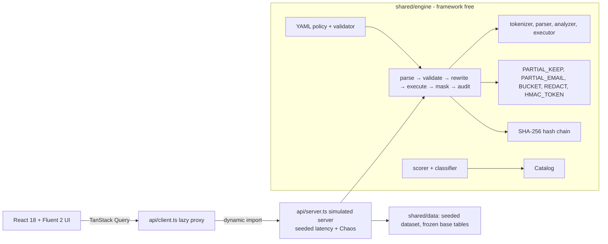

# SmartMask Console

An interactive, high-fidelity **demonstration prototype** of SmartMask, a database-agnostic dynamic data
masking engine for financial data (Smart India Hackathon 2026, AI Frontier Challenge, team QBADS).

> **Honesty notice.** Every record is synthetic (a fictional bank, "Meridian Savings Bank") and the engine is a
> deterministic in-browser simulation. All latency figures are **simulated from a seeded model, not measured
> benchmarks**. The UI says so in a persistent badge, in the environment pill, and on every latency chart.

The masking functions, PII scoring, SQL rewriting, policy validation, hash-chained audit log and Isolation Forest are
real code with tests. What is simulated is the network, the backend databases (an in-memory executor runs the SQL over
generated tables) and the engine overhead timings.

## Quick start

```bash
npm install
npm run dev          # http://localhost:5173
npm run build        # type-check + production build
npm run preview      # serve the build on :4173
npm test             # 87 unit and property tests (Vitest)
npm run e2e          # Playwright: 79 tests (flows, wizards, axe-core light + dark, responsive, keyboard, perf budgets, 18 visual snapshots)
npm run lint         # ESLint, zero warnings allowed
npm run typecheck    # strict TypeScript
npm run size         # gzip size of the JavaScript a route actually loads (needs `npm run preview` running)
```

Useful URL parameters: `?role=support|analyst`, `?theme=dark`, `?fast=1` (removes simulated latency, used by tests).
Press **Ctrl+K** for the command palette and **Ctrl+Shift+E** for the hidden Chaos menu.

## The product facts the UI illustrates

| Fact | Where to see it |
| --- | --- |
| Score `S = 0.30·N + 0.55·P + 0.15·E`; `S ≥ 0.70` ENFORCED, `0.40 ≤ S < 0.70` REVIEW (masked fail-closed), `S < 0.40` CLEAR | Discovery, Review Queue, column drawer |
| ML promotes to `ENFORCED_ML` when `M ≥ 0.85`, never clears | `contacts.nomor_kartu` in Discovery; unit tests |
| Tags `PII_HIGH`, `FINANCIAL_CONFIDENTIAL`, `PII_MEDIUM`; roles Admin / Support / Analyst | Policy Studio matrix, Workbench |
| `4111-XXXX-XXXX-1111`, bucketed balances, `[REDACTED]`, `tok_` + 24 hex | Workbench with the role switch |
| Base tables never change; every query writes a hash-chained audit event | Verification, Audit Trail |
| Overhead budget under 5 ms at P99; PostgreSQL = secure views (A), SQLite and MySQL = AST rewriting (B) | Performance, Workbench "Rewritten SQL" |
| AI recommends, drafts and alerts; it never decides on the query path | Review triage, Policy Copilot, Anomalies |

## Five-minute judge demo

1. **Overview (30 s).** Four KPIs (192 columns, 45 enforced, ~660 queries masked in 24 h, simulated P99 ≈ 4.2 ms), a
   24-hour volume chart by role, the tag donut (click a slice to jump to Discovery filtered by that tag) and the
   activity feed. Every chart has a *View as table* alternative.
2. **Query Workbench (90 s).** Choose *Canonical demo row* and press **Run**. Watch the six-stage strip animate against
   the 4.0 ms budget. Admin sees `4111-1111-1111-1111` and `128450.00`. Click **Support** in the command bar: the same
   result re-masks without re-running, with a character-by-character cross-fade (`4111-XXXX-XXXX-1111`,
   `100,000–149,999`). Click **Analyst**: `tok_…` and `[REDACTED]`. The *Base-table result* pane (labelled
   "Evaluator connection, demo only") never changes. Open the *Rewritten SQL* tab for the diff; on PostgreSQL it also
   shows the secure-view DDL.
   Then try *Joins on identifiers still work* as Analyst (equal inputs give equal tokens), *Literal probe on a tagged
   column* (`SM-PRED-001`), *Derived expression* (`SM-DERIVED-001`) and *Unparseable SQL* (`SM-PARSE-001`).
3. **Discovery and Review (60 s).** Press **Scan** (five stages, rows appear progressively). Filter to `REVIEW`:
   `settlements.order_ref` (S ≈ 0.46, a 16-digit number that is not a card) and `legacy_cards.c1` (card-shaped, S ≈ 0.69)
   sit in the Review Queue with value *shapes* (never raw values), classifier output and an AI triage suggestion.
   **Approve** one (toast with Undo); **Clear** another (needs a justification). The Overview counters and the audit
   trail update. Press **Simulate schema drift** to rename a column and watch the rescan route the new column to review.
4. **Policy Studio (60 s).** Type invalid YAML: the line is flagged and Save is disabled. Ask the Copilot for
   *Redact balances for support*: you get a YAML diff, validation and a golden-query diff; **Approve and publish** bumps
   `policy_version`. Ask for *Let support see full card numbers* to see the guardrail (`SM-POL-003`) refuse it.
5. **Audit Trail and Verification (60 s).** **Verify chain** (8,000 events). Press **Tamper test…**, then Verify again:
   the break is pinpointed and later rows turn amber. Open Verification to see SHA-256 of all 22 base tables unchanged
   before and after each query batch.
6. **Performance and Anomalies (30 s).** Waterfall, P50/P95/P99, budget gauge and the live cache chart (publish a policy
   to watch the hit ratio dip and recover). Anomalies lists three injected incidents (plus a few low-confidence alerts) scored by a real Isolation Forest. Refresh the page to reset all demo state.

## Architecture

```
src/
  app/                 shell, router (URL state), Zustand UI store, overlays (lazy), wizards, drawer
  features/<view>/     nine views: overview discovery review policy workbench verification audit performance anomalies
  entities/            (reserved by the feature-sliced layout; domain types live in shared/engine/types.ts)
  shared/
    engine/            FRAMEWORK-FREE: masking, scoring, policy, SQL tokenizer/parser/analyzer/executor, audit chain,
                       isolation forest, state machines. No React, no DOM.
    data/              deterministic synthetic bank: 22 tables, 192 columns, 8,000 audit events, telemetry, principals
    api/               simulated server (latency, chaos, mutations) + lazy client the UI talks to
    ui/                design tokens, DataTable, charts frame, wizards, code editor, skeletons, toasts
tests/
  unit/                Vitest: engine goldens per role and dialect, property tests, seed and policy tests
  e2e/                 Playwright: nine flows, axe-core, responsive, keyboard, visual snapshots
```



### How a query flows (`shared/engine/pipeline.ts`)

1. **Parse** with a hand-written TypeScript tokenizer and recursive-descent parser (SELECT, aliases, joins, CTEs,
   subqueries, UNION, CASE, IN/EXISTS). Failures raise `SM-PARSE-001` with a source position, which the editor underlines.
2. **Validate** (`sql/analyze.ts`): resolves every column through aliases, CTEs and subqueries down to base columns
   ("lineage"). For Support and Analyst it rejects a tagged column compared with a literal (`SM-PRED-001`) and any
   function or aggregate over a tagged column (`SM-DERIVED-001`). Column-to-column comparisons and joins stay legal, so
   token joins work. `REVIEW` and unknown columns are treated as tagged (fail-closed).
3. **Rewrite**: Approach A (PostgreSQL) points tables at per-role secure views and emits the view DDL; Approach B
   (SQLite, MySQL) wraps projections in dialect-specific functions (`sm_partial_keep(...)`, `SM_BUCKET(...)`, a literal for
   REDACT so no column reference survives). Masking happens only at the outermost projection.
4. **Execute** against the frozen in-memory base tables (hash joins, aggregates, subqueries).
5. **Mask** with the real functions. Tokens are Web Crypto HMAC-SHA-256 with a per-tag key derived through HKDF, so equal
   inputs give equal tokens within a tag.
6. **Audit**: an event with `query_hash`, `requesting_role`, `columns_accessed`, `masking_applied`, `execution_time_ms`,
   `timestamp`, `prev_hash` and `event_hash = SHA-256(prev_hash | canonical JSON)`.

Overhead per stage (parse 0.4–1.5 ms, policy 0.1–0.3, mutation 0.3–1.2, render 0.2–0.8, audit 0.05–0.2, occasional spikes to
4.6 ms, never above 5.0) comes from a **seeded model** (`simulateStages`), clearly labelled as simulated everywhere.

### State machines

All asynchronous flows are explicit finite-state machines with a declared transition table and no implicit transitions
(`shared/engine/fsm.ts`, unit-tested): `idle → loading → success | empty | error` with `retrying` for every data region
(`useLoadMachine` + `<Region>`), a six-stage query pipeline (`parse → validate → rewrite → execute → mask → audit →
done | rejected | failed`) and a five-stage scan. I implemented a tiny table-driven machine instead of XState to keep the
bundle small and the machines framework-free; it satisfies the "XState or equivalent" clause.

### Synthetic data (`shared/data`)

Seeded by mulberry32, so every run is identical. 5,000 customers (Indian, Zimbabwean, UK and US name mixes, plus-addressed
and unicode emails, E.164 phones), Luhn-valid test PANs (4111… and 5555…), mod-97 IBANs, Verhoeff-valid Aadhaar-style
numbers, SSN-style identifiers, log-normal balances up to 2,400,000.00 and 60,000 transactions. The canonical row (card
`4111-1111-1111-1111`, balance `128450.00`) is customer 1.

Edge cases, all present and exercised: a 16-digit non-card `order_ref` (REVIEW, S = 0.46), `nomor_kartu` (rules miss,
classifier promotes, M = 0.95), `c1` holding card-shaped values (REVIEW), the Luhn-failing `4111-2345-6789-1111` legacy
column (S = 0.725), null and empty strings, a mid-demo column rename (schema drift), unicode names, duplicate SSNs across
tables (token joins), and an empty table whose name matches a strong dictionary hit (floored at S = 0.40).

## Design system

* **Tokens**: `shared/ui/tokens.ts` is the only place colour literals live (the light and dark palettes from the brief,
  each tag and status colour as foreground / 10 % tint / border, always paired with an icon or label). Components use
  `--sm-*` CSS variables and Fluent tokens through `FluentProvider`.
* **Type, grid and radii**: Segoe UI Variable stack, the specified ramp, tabular numerals, 4 px grid, 4/8/12 px radii.
* **Materials**: mica app background (3 % noise + 4 % brand tint); acrylic (`blur(30px) saturate(125%)`, 70 % alpha) on
  toasts, drawer, dialogs and flyouts, with an opaque fallback under `prefers-reduced-transparency`.
* **Motion**: decelerate/accelerate curves, 90/150/200/300 ms durations, row insertion slide, 400 ms count-ups, a 160 ms
  character cross-fade on role change; `prefers-reduced-motion` swaps movement for opacity.
* **Adaptive**: compact (< 640 px) overlay blade and card lists, medium (640–1007 px) icon rail, large (≥ 1008 px) 280 px
  blade with a persisted collapse to a 48 px rail, 12-column grid, 1600 px max width.

## Decisions I made without asking (per the brief)

* **Hash router** (`#/view?params`) so the static build works from any host and Back/Forward are native.
* **TanStack Table v8** (v9 is a different, still-new API) with TanStack Virtual; **recharts 3**; **CodeMirror 6**.
* **Audit `execution_time_ms` = SmartMask overhead** (the number the 5 ms budget applies to), not backend time.
* **8,000 audit events are the whole retained window** and drive the telemetry, so the Overview, Performance and Audit
  views always agree (about 570 queries a day). Per-minute counts are therefore small; charts aggregate to hours.
* **Support PII_MEDIUM** uses family-aware partial masking (PARTIAL_EMAIL for emails); **Analyst** gets tokens for
  `PII_HIGH` and `[REDACTED]` for `FINANCIAL_CONFIDENTIAL` and `PII_MEDIUM`.
* **NULL and empty strings pass through masking** (they reveal only absence); `PARTIAL_KEEP` never reveals more than half
  of a value, so very short values cannot leak in full.
* **Schema drift** renames `contacts.contact_phone` to `handset` in the schema view only; row data and therefore base-table
  checksums are untouched. Until the rescan the unknown column is masked fail-closed.
* **Add backend** registers an empty synthetic backend (a connection, no tables), which exercises the empty state.
* **Copilot** is a deterministic request-to-YAML drafter (no LLM call); it can only produce a draft that a human approves,
  and the validator's guardrails still apply to it.
* **Clear** and **Override** are separate decisions: Clear sets `CLEAR`; the Override wizard sets `OVERRIDDEN` (force a tag,
  or unmask) with a justification written to the audit trail.

## Quality notes and known limits

* Strict TypeScript, zero `any`, no TODOs, ESLint with `--max-warnings 0`.
* Bundle: see the numbers in the self-review below. The engine, dataset and server load as a separate chunk so the shell
  paints first.
* The in-browser executor supports the SQL the demo needs (SELECT/joins/CTEs/subqueries/UNION/aggregates/basic functions).
  It is not a general database; unsupported functions return a parse-class error.
* Latency, throughput and cache figures are simulated. Do not quote them as benchmarks.

## Self-review checklist

See [`SELF_REVIEW.md`](./SELF_REVIEW.md) for the requirement-by-requirement checklist with evidence and any deviations.
